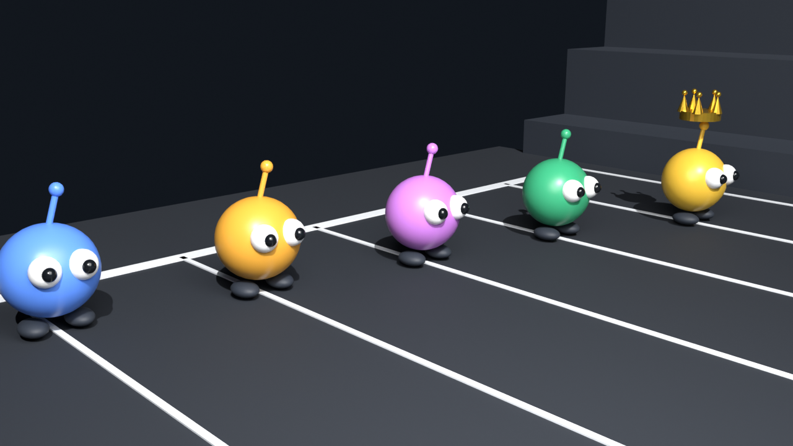

# Rayan's Arène — modèles 3D (Blender)

Les robots de l'Arène en 3D, fabriqués par un script Blender (aucun clic) : même allure que dans la tuile Arène de
Rayan's Mobile (corps rond, deux grands yeux, antenne, petits pieds), une couleur par famille de règle.



| Fichier (`sorties/`) | Contenu |
| --- | --- |
| `robot-croisement` (bleu), `robot-rebond` (orange), `robot-momentum` (violet), `robot-tendance` (vert) | les 4 familles de règles |
| `robot-acheter-et-garder` (doré) | le robot de référence |
| `couronne` | pour le meilleur robot |
| `arene` | piste de 6 couloirs (40 m), gradins, grand écran |

Chaque modèle existe en `.fbx` et en `.glb`. Environ 3 600 triangles par robot ; 1 unité = 1 mètre, un robot fait
environ 1,7 m avec l'antenne ; le point de référence est sous les pieds, l'avant regarde vers −Y dans Blender.

## Dans Roblox Studio

Accueil → **Importer en 3D** → choisir un `.fbx` (ou `.glb`) de `sorties/` → Importer. Le modèle arrive dans
l'espace de travail (MeshPart) ; on peut le ranger dans ReplicatedStorage et le cloner par script.

## Refaire les modèles

```bash
blender -b --python blender/arene/modeles.py
```

Modifier les couleurs ou les formes dans `modeles.py`, relancer : tout est réexporté avec un nouvel aperçu.
Avec Claude relié à Blender (MCP for Blender sur le PC), on peut aussi les retoucher directement dans Blender.
