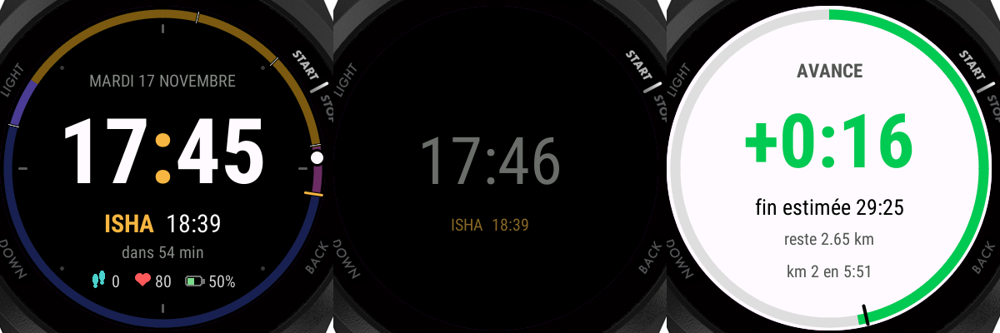

# Rayan's Garmin

Trois apps Connect IQ pour la **Forerunner 165** (et 165 Music), écrites en Monkey C avec le kit officiel de Garmin.
Rien n'est piraté : la montre accepte les apps de développeur copiées par câble USB.

| App | Dossier | Type | Ce qu'elle fait |
| --- | --- | --- | --- |
| Rayan's Prière (cadran) | [`cadran-priere/`](cadran-priere/) | cadran | Heure, date, **prochaine prière** et temps restant, anneau qui se remplit jusqu'à la prochaine prière (ambre dans les 15 dernières minutes), pas, cœur, batterie. Écran toujours allumé : affichage réduit qui se décale chaque minute. |
| Rayan's 5 km | [`champ-5km/`](champ-5km/) | champ de données | Pendant une course : **avance ou retard** sur le temps visé, temps final estimé, distance restante ; alerte à chaque km (temps du km, écart) ; après 5 km, le vrai temps sur 5 km. |
| Rayan's Muscu | [`muscu/`](muscu/) | app | **Tractions** ou **pompes** : répétitions comptées au poignet, objectif par série, repos minuté (vibre à 10 s et à la fin), séries restantes, dernière séance rappelée. Enregistrée comme activité « Musculation » dans Garmin Connect (un circuit par série, répétitions par circuit et au total). |




## Design

- **Cadran** : anneau de 24 h (midi en haut, minuit en bas) aux couleurs de la lumière du jour — nuit (bleu),
  aube de Fajr au lever (violet), jour (or sombre), crépuscule de Maghrib à Isha (prune). Un trait par prière (la
  prochaine en or), un point blanc pour l'heure actuelle. Heure en Roboto Condensed gras, deux-points en or.
- **Muscu** : accueil en deux cartes avec pictogramme ; pendant la série, l'anneau se remplit vers l'objectif
  (or, puis vert) ; pendant le repos, il se vide (bleu, puis or) ; points des séries ; histogramme à la fin.
- **5 km** (champ en plein écran) : anneau de distance coloré selon l'écart, trait du temps visé (où il faudrait
  être maintenant), dernier kilomètre.
- Polices vectorielles de la montre (`Graphics.getVectorFont`) avec repli sur les polices système.

## Détails

- **Horaires de prière** : même calcul que Rayan's Prière (`priere/src/core/praytimes.ts`), refait en Monkey C
  (`cadran-priere/source/Priere.mc`, en Double). Les tests comparent à la minute près avec le code de Prière.
  Position : dernière position connue de la montre (GPS d'une activité, météo), gardée sur la montre ; Rennes tant
  qu'il n'y en a aucune ; ou saisie à la main dans les réglages. Méthode UOIF par défaut, comme Prière.
- **Comptage des répétitions** (`muscu/source/Compteur.mc`) : la main est fixe (barre, sol), c'est l'inclinaison
  de l'avant-bras qui oscille. Enveloppe haut/bas sur l'axe qui bouge le plus, hystérésis à 30 % de l'amplitude,
  amplitude minimale (sensibilité réglable) et temps minimum entre deux répétitions. Testé sur des mouvements
  simulés, **pas encore sur le vrai poignet** : HAUT / BAS corrigent le compte (pendant la série, ou pendant le
  repos pour la série qui vient de finir).
- **Valeurs par défaut** reprises de Rayan's Aujourd'hui (`aujourdhui/src/core/sport.ts`) : tractions strictes 5 × 7,
  repos 120 s ; pompes 4 × 15, repos 90 s ; 5 km visé en 30:00 (à régler : le temps visé du test 5 km dans
  Aujourd'hui).

## Lien avec Rayan's Aujourd'hui

Montre branchée au PC (USB) pendant qu'Aujourd'hui tourne : en 2 minutes au plus, les séances de Rayan's Muscu et
les courses sont ajoutées au journal sport, puis partent sur l'iPhone avec la synchro habituelle. Une saisie déjà
faite ce jour-là pour le même exercice (ou la même course) l'emporte. Détails : « Sport » dans
[`aujourdhui/README.md`](../aujourdhui/README.md). Dans le fichier de la montre, un circuit = une série et le repos
qui suit, donc une correction faite pendant le repos est bien prise en compte.

## Boutons de Rayan's Muscu

| Écran | START | HAUT / BAS | RETOUR |
| --- | --- | --- | --- |
| Prêt | commence la série 1 | — | quitte |
| Série | fin de la série → repos | +1 / −1 | fin de séance (Enregistrer / Reprendre / Supprimer) |
| Repos | série suivante | corrige la série finie | fin de séance |

## Réglages

Dans l'app **Garmin Connect** du téléphone : Appareils → Forerunner 165 → Activités et applications (ou Cadrans) →
l'app → Réglages. Cadran : méthode, Asr, décalage en minutes, position manuelle. 5 km : temps visé (`29:30`),
alertes par km. Muscu : séries, répétitions, repos de chaque exercice, sensibilité du comptage.

## Installer sur la montre

1. Brancher la montre en USB : elle apparaît dans l'Explorateur (« Forerunner 165 »).
2. `.\construire.ps1 -Installer` : compile et copie les `.prg` dans `Internal Storage\GARMIN\Apps`. À la main, il
   faut d'abord retirer l'ancien `.prg` de la montre : une copie ne remplace pas un fichier existant.
3. Débrancher.
4. Cadran : appui long sur l'écran de l'heure → Cadran → Rayan's Prière. Champ 5 km : Course → réglages →
   Écrans de données → un champ → Connect IQ → Rayan's 5 km. Muscu : START → Rayan's Muscu.

Une app copiée à la main n'est pas mise à jour par Garmin : recopier le `.prg` après chaque changement.

## Développement

Il faut Java, le **Connect IQ SDK Manager** (compte Garmin) avec un SDK et les fichiers de la Forerunner 165, et une
clé de développeur dans `%APPDATA%\Garmin\ConnectIQ\developer_key.der` (jamais dans le dépôt : elle signe les apps).

```powershell
.\construire.ps1            # compile les trois apps pour fr165
.\construire.ps1 -Tests     # tests dans le simulateur (horaires, comptage, champ 5 km)
```

Simulateur : `monkeydo sortie\muscu.prg fr165` (le simulateur se place au siège de Garmin, au Kansas : les horaires
affichés y sont ceux du Kansas à l'heure du PC).
