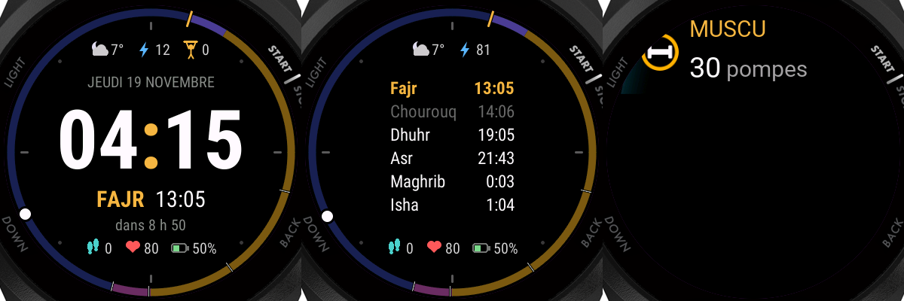
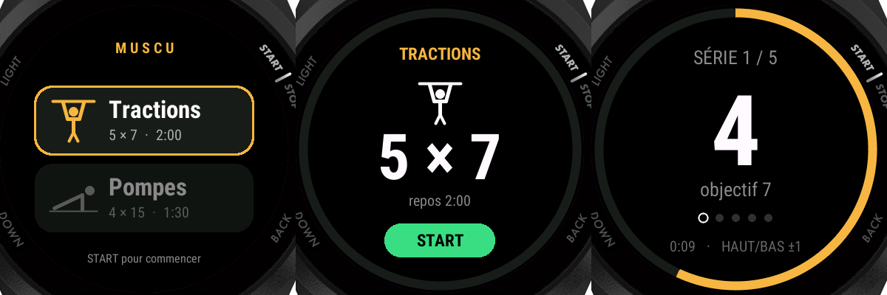
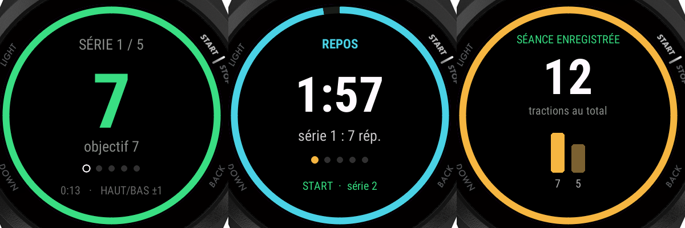

# Rayan's Garmin

Trois apps Connect IQ pour la **Forerunner 165** (et 165 Music), écrites en Monkey C avec le kit officiel de Garmin.
Rien n'est piraté : la montre accepte les apps de développeur copiées par câble USB.

| App | Dossier | Type | Ce qu'elle fait |
| --- | --- | --- | --- |
| Rayan's Prière (cadran) | [`cadran-priere/`](cadran-priere/) | cadran | Heure, date, **prochaine prière** et temps restant sur un anneau solaire de 24 h ; en haut météo, Body Battery et répétitions de Muscu ; en bas pas, cœur, batterie, notifications. **Appui long** sur une info pour ouvrir l'écran qui va avec (Muscu compris) ; sur la prière, les six horaires du jour. **Alerte à l'heure de chaque prière** : notification de la montre « C'est l'heure de Asr — 15:20 », avec vibration. Écran toujours allumé : affichage réduit qui se décale chaque minute. |
| Rayan's 5 km | [`champ-5km/`](champ-5km/) | champ de données | Pendant une course : **avance ou retard** sur le temps visé, temps final estimé, distance restante ; alerte à chaque km (temps du km, écart) ; après 5 km, le vrai temps sur 5 km. |
| Rayan's Muscu | [`muscu/`](muscu/) | app | **Tractions** ou **pompes**, comme une course : le chrono part dès le choix, START passe de la série (répétitions comptées au poignet) à la pause (chrono), puis à la série suivante ; RETOUR termine. Compteurs du jour et de toujours par exercice. **Aperçu dans la liste des widgets** (répétitions du jour) et raccourci sur le cadran. Réglages sur la montre. Enregistrée comme activité « Musculation » (un circuit par série). |






## Design

- **Cadran** : anneau de 24 h (midi en haut, minuit en bas) aux couleurs de la lumière du jour — nuit (bleu),
  aube de Fajr au lever (violet), jour (or sombre), crépuscule de Maghrib à Isha (prune). Un trait par prière (la
  prochaine en or), un point blanc pour l'heure actuelle. Heure en Roboto Condensed gras, deux-points en or.
  Ligne du haut : météo (icône soleil, lune, nuage, pluie, neige, orage), Body Battery (éclair bleu), répétitions
  du jour de Muscu (bonhomme à la barre, en or dès qu'il y en a). Pas en or quand l'objectif du jour est atteint.
- **Muscu** : accueil en deux cartes avec pictogramme ; pendant la série, l'anneau se remplit vers l'objectif
  (or, puis vert) ; pendant le repos, il se vide (bleu, puis or) ; points des séries ; histogramme à la fin.
- **5 km** (champ en plein écran) : anneau de distance coloré selon l'écart, trait du temps visé (où il faudrait
  être maintenant), dernier kilomètre.
- Polices vectorielles de la montre (`Graphics.getVectorFont`) avec repli sur les polices système.

## Détails

- **Horaires de prière** : même calcul que Rayan's Prière (`priere/src/core/praytimes.ts`), refait en Monkey C
  (`cadran-priere/source/Priere.mc`, en Double). Les tests comparent à la minute près avec le code de Prière.
  Position : dernière position connue de la montre (GPS d'une activité, météo), gardée sur la montre ; Rennes tant
  qu'il n'y en a aucune ; ou saisie à la main dans les réglages. Méthode UOIF par défaut, comme Prière.
- **Comptage des répétitions** (`muscu/source/Compteur.mc`) : la main est fixe (barre, sol), c'est l'inclinaison
  de l'avant-bras qui oscille. Enveloppe haut/bas sur l'axe qui bouge le plus, hystérésis à 30 % de l'amplitude,
  amplitude minimale (sensibilité réglable) et temps minimum entre deux répétitions. Testé sur des mouvements
  simulés, **pas encore sur le vrai poignet** : HAUT / BAS corrigent le compte (pendant la série, ou pendant le
  repos pour la série qui vient de finir).
- **Alerte de prière** (`cadran-priere/source/Alerte.mc`) : le cadran programme un réveil à l'heure de la prochaine
  prière ; le service en arrière-plan affiche une notification de la montre (vibration des notifications), puis
  programme la suivante. Chourouq n'a pas d'alerte. Fonctionne tant que Rayan's Prière est le cadran actif.
- **Valeurs par défaut** : objectif 7 tractions / 15 pompes par série (comme le programme d'Aujourd'hui), pas de
  rappel de pause ; 5 km visé en 30:00.

## Lien avec Rayan's Aujourd'hui

Montre branchée au PC (USB) pendant qu'Aujourd'hui tourne : en 2 minutes au plus, les séances de Rayan's Muscu et
les courses sont ajoutées au journal sport, puis partent sur l'iPhone avec la synchro habituelle. Une saisie déjà
faite ce jour-là pour le même exercice (ou la même course) l'emporte. Détails : « Sport » dans
[`aujourdhui/README.md`](../aujourdhui/README.md). Dans le fichier de la montre, un circuit = une série et le repos
qui suit, donc une correction faite pendant le repos est bien prise en compte.

## Appui long sur le cadran

| Zone | Ouvre |
| --- | --- |
| Météo | la météo de la montre |
| Éclair (Body Battery) | la Body Battery |
| Bonhomme (Muscu) | **Rayan's Muscu** directement |
| Pas · cœur · batterie · enveloppe | l'écran correspondant de la montre |
| Prochaine prière | les six horaires du jour pendant 8 s (nouvel appui : retour) |

Ailleurs, l'appui long garde son rôle habituel (choix du cadran). Le raccourci Muscu passe par une
« complication » publiée par Muscu (`muscu/source/Raccourci.mc`, visible seulement par les apps de la même clé) :
la tuile n'apparaît qu'une fois Muscu installée et ouverte au moins une fois.

## Mettre les apps en premier (sur la montre)

- **Liste des widgets** (HAUT ou BAS depuis le cadran) : maintenir HAUT → Apparence → Aperçus → choisir Rayan's
  Muscu → la monter tout en haut.
- **Liste des activités** (START) : Activités et applications → Rayan's Muscu → Réorganiser → en haut.
- **Course** : mettre Rayan's 5 km sur le premier écran de données (Course → réglages → Écrans de données).

## Boutons de Rayan's Muscu

| Écran | START | HAUT / BAS | RETOUR |
| --- | --- | --- | --- |
| Accueil | lance l'exercice choisi (le chrono part) ou ouvre Réglages | choisir | quitte |
| Série | pause (la série compte) | +1 / −1 répétition | fin de séance (Enregistrer / Reprendre / Supprimer) |
| Pause | série suivante | corrige la série qui vient de finir | fin de séance |

Pendant la séance, l'écran tactile est ignoré (sol, transpiration) : seulement les boutons. À la fin, une série en
cours compte si elle a au moins une répétition.

## Réglages (sur la montre)

Une app copiée par câble ne se règle pas depuis Garmin Connect : les réglages sont sur la montre.

- **Cadran** : appui long sur le cadran → Personnaliser (ou Réglages) : alerte à chaque prière (oui/non), moment
  de l'alerte (à l'heure, 5 à 30 min avant), méthode de calcul, Asr, décalage des horaires.
- **Muscu** : bouton Réglages de l'accueil : objectif par série (libre ou 3 à 50), rappel de pause (aucun ou 0:45
  à 5:00, la montre vibre), sensibilité du comptage.
- **5 km** : temps visé 30:00 (à changer dans `champ-5km/resources/settings/properties.xml`, puis réinstaller).
## Installer sur la montre

1. Brancher la montre en USB : elle apparaît dans l'Explorateur (« Forerunner 165 »).
2. `.\construire.ps1 -Installer` : compile et copie les `.prg` dans `Internal Storage\GARMIN\Apps`. À la main, il
   faut d'abord retirer l'ancien `.prg` de la montre : une copie ne remplace pas un fichier existant.
3. Débrancher.
4. Cadran : appui long sur l'écran de l'heure → Cadran → Rayan's Prière. Champ 5 km : Course → réglages →
   Écrans de données → un champ → Connect IQ → Rayan's 5 km. Muscu : START → Rayan's Muscu. Alerte de prière : autoriser les notifications de Rayan's Prière si la montre le demande.

Une app copiée à la main n'est pas mise à jour par Garmin : recopier le `.prg` après chaque changement.

## Développement

Il faut Java, le **Connect IQ SDK Manager** (compte Garmin) avec un SDK et les fichiers de la Forerunner 165, et une
clé de développeur dans `%APPDATA%\Garmin\ConnectIQ\developer_key.der` (jamais dans le dépôt : elle signe les apps).

```powershell
.\construire.ps1            # compile les trois apps pour fr165
.\construire.ps1 -Tests     # tests dans le simulateur (horaires, comptage, champ 5 km)
```

Simulateur : `monkeydo sortie\muscu.prg fr165` (le simulateur se place au siège de Garmin, au Kansas : les horaires
affichés y sont ceux du Kansas à l'heure du PC).
